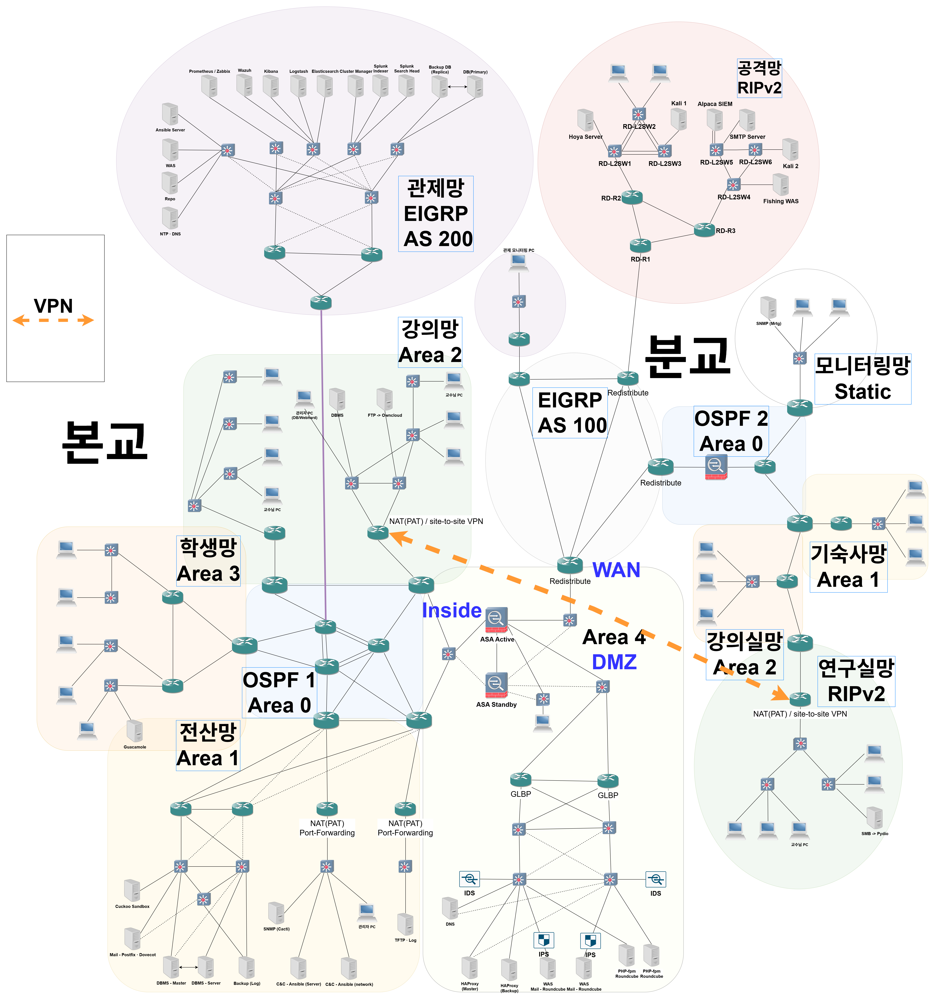

# 네트워크 설계·구축 포트폴리오

본교·분교를 연결하는 가상 캠퍼스 네트워크 설계·구축 프로젝트에 참여함. 인프라 연동을 조율하고, 패킷과 로그를 대조해 네트워크 접근제어 정책을 검증함.

## 주요 경험

- **네트워크 설계·라우팅** — 캠퍼스 구역별 VLAN·서브넷 분리, OSPF Area·ABR·Stub/NSSA 구성, EIGRP·RIPv2 재분배를 통한 라우팅 도메인 연동
- **가용성 설계·검증** — HSRP·GLBP 게이트웨이 구성, PVST 기반 중복 경로 구성, ASAv Active/Standby 역할 절체와 통신 상태 분석
- **접근 통제·VPN** — DMZ와 내부망의 통신 경계 정의, NAT/PAT·ACL·방화벽 정책 구성, GRE over IPsec과 터널 MTU·TCP MSS 설정
- **장애 분석·운영 연계** — 장비 상태·라우팅 정보·Wireshark 캡처 대조, SNMP 모니터링·중앙 로그·장비 설정 백업의 관리 경로 구성

## [가용성과 접근 통제를 고려한 대학 캠퍼스 네트워크 설계·구축](projects/03-campus-network/README.md)

**기간** 2026.09 – 2026.10

[프로젝트 요약](projects/03-campus-network/README.md) · [검증 및 장애 분석](projects/03-campus-network/DETAIL.md#장애-분석과-후속-검증)

*본교·분교의 라우팅 영역과 DMZ, 관제·공격 실습망 및 연구망 VPN 연결 구성.*

[구성도 원본 확대 보기](assets/campus-network-topology.png)

## [쇼핑몰 서비스망 설계·구축과 접근 제어 검증](projects/02-shopping-network/README.md)

**기간** 2026.08.03 ~ 2026.08.14

네트워크팀 팀장으로 코어망·서비스망의 설계와 구축을 맡고, 라우팅 연동과 장비 관리 접근 정책을 검증함.

[프로젝트 요약](projects/02-shopping-network/README.md) · [검증 및 장애 분석](projects/02-shopping-network/DETAIL.md#장애-분석과-후속-검증)
