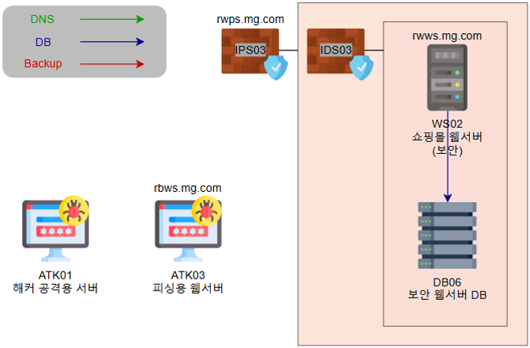
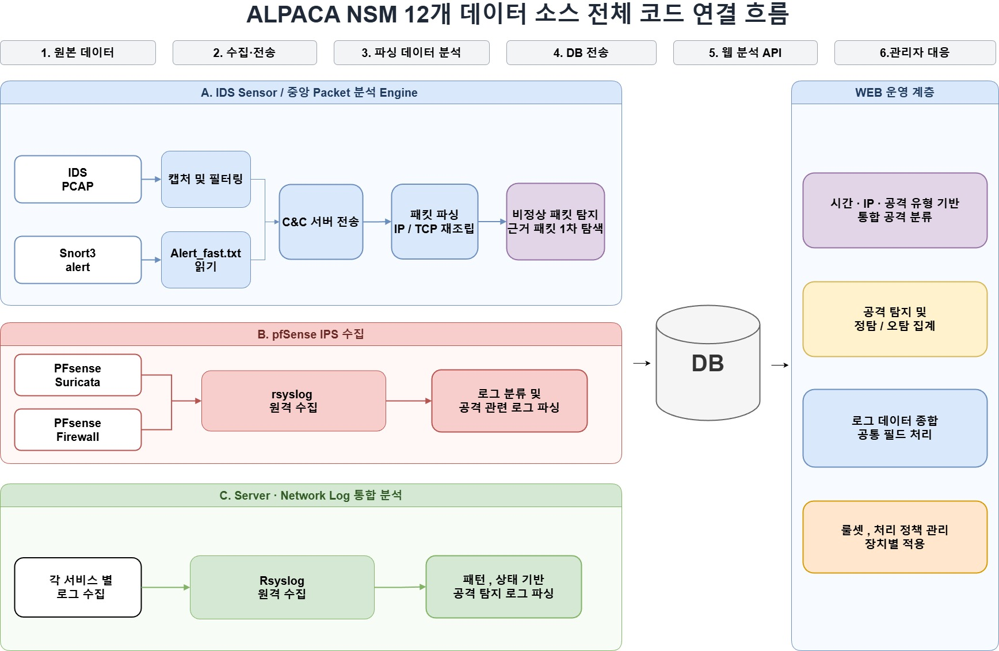
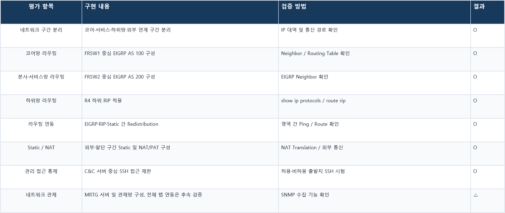

# 쇼핑몰 서비스망 설계·구축 상세 기록

[프로젝트 요약](README.md) · [포트폴리오 메인](../../README.md)

[랩 구성과 검증](#랩-구성과-검증) · [구역과 라우팅](#구역과-라우팅-설계) · [접근 제어](#주소-변환과-관리-접근-제어) · [운영 연계](#운영-연계) · [장애 분석](#장애-분석과-후속-검증)

## 소개와 범위

2026년 8월 3일~14일에 GNS3 격리 훈련망에서 쇼핑몰 서비스를 구축하고, 서비스 운영에 필요한 통신과 모의해킹 시 발생하는 트래픽의 탐지·대응을 함께 점검함. 네트워크팀 팀장으로 망 설계·구축과 영역별 작업 조율을 맡았으며, 라우팅·주소 변환·접근 정책을 구성하고 검증함.

## 랩 구성과 검증

| 영역 | 랩에서 한 일 |
| --- | --- |
| 쇼핑몰 서비스 | 외부 연계 구간의 쇼핑몰 웹과 사설망 DB를 연결해 서비스에 필요한 데이터 조회 경로를 구성함. |
| 모의 보안 점검 | 격리된 환경에서 쇼핑몰 웹 애플리케이션의 인증·세션 처리와 입력값 검증을 점검하고, 발견 사항을 탐지 결과와 비교함. |
| 보안 관제 | Snort 3 IDS 경보, 패킷 캡처, 웹 접근 로그를 대조해 주요 시나리오의 탐지를 확인함. 적용된 일부 IPS 정책에서 차단이 관찰됐으며, 장비 전반에 대한 정책 배포와 검증은 후속 과제로 남김. |

*격리 실습망의 쇼핑몰 웹·DB 및 IDS·IPS 구성.*

*IDS 패킷·경보와 서버 로그를 수집해 중앙에서 분석하는 관제 흐름.*

서버·모의 점검·관제 영역의 작업은 프로젝트 전체 수행 범위임. 이 중 직접 맡은 영역은 각 구성 요소가 통신할 수 있도록 네트워크 경로와 접근 정책을 마련하고, 통합 과정에서 생긴 연결 문제를 점검하는 일이었음.

## 구역과 라우팅 설계

| 구역 | 구성 | 설계 목적 |
| --- | --- | --- |
| 코어망 | FRSW1, EIGRP AS 100 | 코어 구간의 경로 교환 |
| 서비스망 | FRSW2, EIGRP AS 200 | 쇼핑몰과 연계 서비스의 경로 교환 |
| 하위망 | RIP | 하위 네트워크의 경로 학습 |
| 말단·외부 연계 | 정적 경로, NAT/PAT | 외부 연결과 주소 변환 |

라우팅 영역 경계에서 필요한 경로를 재분배함. EIGRP 이웃 형성, 라우팅 테이블의 경로 학습, 구역 간 통신을 각각 확인함.

## 주소 변환과 관리 접근 제어

외부 연계 구간에서 NAT/PAT 변환 정보와 실제 통신 결과를 확인함. 관리용 SSH에는 출발지에 따른 접근 정책을 적용하고 허용·비허용 구간에서 접속을 시험함.

### 외부 웹과 사설망 DB 통합

영역별로 구축을 먼저 진행해 출발지·목적지·포트 요구사항을 사전에 충분히 맞추지 못함. 구성 요소를 합치는 단계에서 새 통신 요구가 생길 때마다 네트워크 경계의 포트 포워딩을 추가로 조정해야 했음.

대표적으로 NAT outside 구간의 쇼핑몰 웹이 사설망 DB를 조회해야 했음. 웹에서 DB로 들어오는 연결을 내부 서버로 전달하도록 포트 포워딩을 구성함. 이 경험을 바탕으로 다음 통합 작업에서는 서비스별 출발지·목적지·방향·필요 포트를 먼저 정리하고, 서비스 연결과 관리 접근을 각각 검증하는 편이 반복 작업을 줄일 수 있다고 판단함.

## 운영 연계

별도 관제망에서 SNMP 기반 장비 상태와 트래픽 수집을 확인함. 전체 네트워크 랩과 MRTG 서버의 최종 연동은 후속 과제로 남김.

### 네트워크 구현도 평가

## 장애 분석과 후속 검증

### EIGRP Key-chain 인증 불일치

인증 설정이 일치하지 않을 때 이웃 관계가 해제되고 학습 경로가 줄어드는 현상을 확인함. 이웃 상태와 라우팅 테이블을 대조해 경로 누락이 인접 관계 변화와 연결됨을 확인함.

### 관리 서버의 SSH 접속 장애

관리 서버에서 일부 장비의 SSH 접속이 실패함. Ping으로 구간별 연결을 확인하고, 라우팅·NAT·ACL·SSH 설정을 순서대로 점검해 접속 장애를 해결함.

[프로젝트 요약](README.md) · [포트폴리오 메인](../../README.md)
