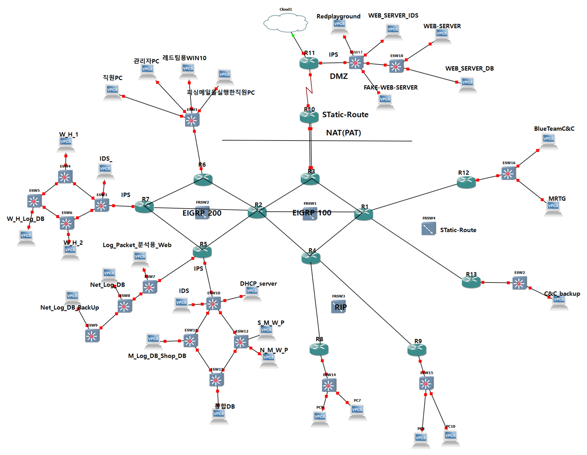

# 쇼핑몰 서비스망 설계·구축과 접근 제어 검증

**[상세히 보기](DETAIL.md)** · [포트폴리오 메인](../../README.md)

[프로젝트 소개](#프로젝트-소개) · [설계 목표](#설계-목표) · [담당 역할](#담당-역할) · [주요 결과](#주요-결과) · [핵심 작업](#핵심-작업) · [문제 해결](#문제-해결)

## 프로젝트 소개

쇼핑몰과 연계 서비스를 운영하는 가상 네트워크를 구성함. 코어망·서비스망·하위망을 구분하고, 서로 다른 라우팅 구역 간 경로 전달과 외부 연계 구간의 주소 변환을 검증함. 쇼핑몰 DMZ의 서비스 통신과 장비 관리용 SSH 접속을 구분해 접근 정책을 적용함.

| 항목 | 내용 |
| --- | --- |
| 수행 시기 | 2026년 8월 3일 ~ 8월 14일 |
| 프로젝트 배경 | 쇼핑몰 인프라 구축 및 모의해킹과 보안 솔루션 점검 |
| 환경 | GNS3, Cisco Router/Switch |
| 망 구성 | Frame Relay, VLAN |
| 라우팅 | EIGRP AS 100·200, RIP, Static Routing, Route Redistribution |
| 접근 제어 | NAT/PAT, ACL, SSH |
| 검증·운영 | EIGRP Key-chain, 라우팅 테이블·NAT 변환 확인, SNMP·MRTG |

*코어망 EIGRP AS 100, 서비스망 AS 200, 하위 RIP 구역과 DMZ·관리망의 연결 구성.*

[구성도 원본 확대 보기](../../assets/shopping-network-topology.png)

[구역별 네트워크 구성 보기](DETAIL.md#구역과-라우팅-설계)

## 설계 목표

| 설계 항목 | 주요 내용 |
| --- | --- |
| 구역 분리 | 코어·서비스·하위·외부 연계 구간을 용도에 따라 구분 |
| 라우팅 연동 | EIGRP·RIP·정적 경로 구간에 필요한 경로를 재분배 |
| 통신 경계 | 외부 연계 구간의 주소 변환과 장비 관리 접근 정책 구성 |
| 운영 검증 | 라우팅 이웃과 경로 학습, NAT 변환, SSH 접속, SNMP 수집을 각각 확인 |

## 담당 역할

- **네트워크 설계·구축 조율** — 네트워크팀 팀장으로 구역별 설계와 구축을 맡고, 팀원 간 작업과 서비스 연동을 조율함.
- **라우팅·접근 정책 구성** — 코어·서비스·말단 구간의 경로를 연동하고, NAT/PAT·ACL과 장비 관리용 SSH 접근 정책을 구성함.
- **장애 점검·검증 기록** — 관리 서버의 SSH 접속 장애를 구간별로 점검하고, 라우팅 인증 설정에 따른 이웃·경로 변화를 확인함.

## 주요 결과

| 항목 | 확인 범위 |
| --- | --- |
| 구역·라우팅 구성 | FRSW1 코어망의 EIGRP AS 100, FRSW2 서비스망의 EIGRP AS 200을 하위 RIP·정적 경로 구간과 연동함. |
| 경로 전달 | EIGRP 이웃 형성과 재분배 경로 학습을 확인함. |
| 주소 변환 | NAT/PAT 변환 정보와 내부·외부 간 통신을 확인함. |
| 관리 접근 | 관리 구간에 장비 SSH 접근을 제한하고, 허용·비허용 출발지에서 접속을 시험함. |
| 라우팅 인증 | Key-chain 인증 불일치 시 EIGRP 이웃 관계가 끊기고 학습 경로가 줄어드는 현상을 확인함. |
| 모니터링 | 별도 관제 환경에서 SNMP 수집을 확인함. 전체 랩과 MRTG 서버의 최종 연동은 후속 과제로 남김. |

## 핵심 작업

### 코어망·서비스망 분리와 라우팅 연동

FRSW1을 중심으로 코어망을, FRSW2를 중심으로 서비스망을 구성함. 하위 구역에는 RIP를 적용하고, 기타 말단과 외부 연계 구간에는 정적 경로를 적용함. 구역별 경계에서 필요한 경로를 재분배하고, 이웃 상태와 라우팅 테이블에서 경로 학습을 확인함.

### NAT/PAT·ACL을 통한 통신 경계 구성

외부 연계 구간에 NAT/PAT를 적용하고, 변환 정보와 실제 통신 결과를 확인함. 장비 관리용 SSH는 지정된 관리 구간에서만 접근할 수 있도록 구성하고, 출발지별 접속 결과를 비교함.

### SNMP 수집과 관제 연계

별도 관제 네트워크에서 SNMP를 이용한 장비 상태와 트래픽 수집을 확인함. 전체 랩에서의 통합 관제는 추가 검증 과제로 정리함.

## 문제 해결

### EIGRP 인증 불일치로 인한 이웃 관계 해제

Key-chain 인증 설정이 일치하지 않을 때 EIGRP 이웃 관계가 끊기고 학습 경로가 줄어드는 현상을 확인함. 인증 설정과 이웃 상태·라우팅 테이블을 비교해 경로 누락의 원인을 좁힘.

### 관리 서버에서 일부 장비의 SSH 접속 실패

Ping으로 구간별 연결 상태를 확인한 뒤 라우팅, NAT, ACL, 장비의 SSH 설정을 순서대로 점검해 접속 장애를 해결함.

[검증 및 장애 분석](DETAIL.md#장애-분석과-후속-검증)

**[상세히 보기](DETAIL.md)** · [포트폴리오 메인](../../README.md)
