# 대학 캠퍼스 네트워크 설계·구축 상세 기록

[프로젝트 요약](README.md) · [포트폴리오 메인](../../README.md)

[소개와 범위](#소개와-범위) · [라우팅](#구역과-라우팅-설계) · [이중화](#계층별-이중화와-검증-범위) · [VPN·통제](#접근-통제와-vpn) · [장애 분석](#장애-분석과-후속-검증)

## 소개와 범위

> 외부 운영망과 분리된 GNS3·VMware 실습 환경에서 수행한 네트워크 설계·구축 프로젝트임.

2026년 9월 – 10월에 대학 캠퍼스 인프라를 대상으로 연결성·가용성·접근 통제·운영성을 고려한 네트워크를 설계·구현함. 서버 서비스와 보안 검증은 통신 경로와 운영 정책의 관점에서 연계함.

*캠퍼스 구역과 주요 기술을 요약한 설계 개념도.*

## 구역과 라우팅 설계

| 구역 | 구성 | 설계 목적 |
| --- | --- | --- |
| 본교 코어 | OSPF 백본·ABR | 용도별 Area 연결 |
| 전산망 | VLAN·HSRP·PVST | 서비스·관리 구역과 중복 경로 구성 |
| 강의·학생망 | VLAN·OSPF·DHCP | 사용자 구역 분리와 접속 제공 |
| DMZ | ASAv·SVI·GLBP | 외부 공개 서비스의 통신 경계 |
| 분교·연구망 | OSPF·RIPv2·GRE/IPsec | 캠퍼스 간 연구·관리 연결 |
| 외부 코어 | EIGRP·Redistribution | 이종 라우팅 도메인 연동 |
| 운영망 | SNMP·로그·설정 백업 | 상태 확인·장애 분석·복구 준비 |

[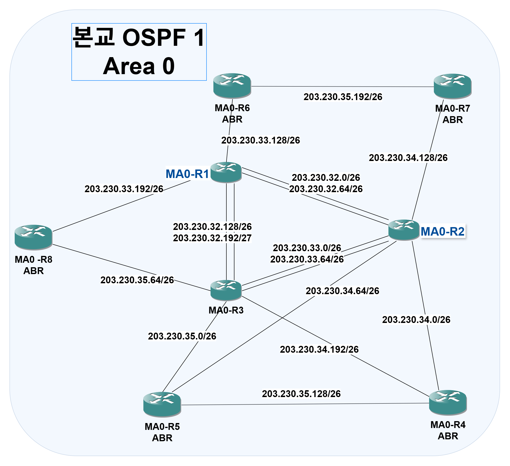](../../assets/main-campus-core-logical.png)

*본교 Area 0의 코어 라우터 간 연결과 각 구역으로 이어지는 ABR 배치.*

[구성도 원본 확대 보기](../../assets/main-campus-core-logical.png)
OSPF Area 1에는 Stub/no-summary, Area 4에는 NSSA 구성을 반영함. 구역별 경로 학습과 경계 라우터의 연결 구조를 중심으로 정리함.

경로 검증은 이웃 형성, 목적지 경로 학습, 실제 전송과 반환 경로의 순서로 확인하도록 정리함.

| 확인 지점 | 확인 방법 | 판단 기준 |
| --- | --- | --- |
| OSPF 이웃 | show ip ospf neighbor | 의도한 장비 사이 인접 관계 |
| 경로 출처 | show ip route | 내부·외부 경로와 next hop |
| 전달 경로 | traceroute·패킷 캡처 | 의도한 경계·목적지로 전달 |
| 양방향 통신 | 송수신 결과 대조 | 요청뿐 아니라 응답 반환 확인 |

재분배 정책의 추가 검증 항목은 경로 필터·메트릭·태그와 장애 시 수렴 시간임.

## 계층별 이중화와 검증 범위

| 계층 | 기술 | 구성·검토 내용 | 남은 검증 |
| --- | --- | --- | --- |
| 기본 게이트웨이 | HSRP | 동일 VIP·priority·preempt 설정 | 절체 패킷·손실·복구 시간 |
| DMZ 게이트웨이 | GLBP | VLAN별 VIP·priority·preempt 설정 | 장애 조건별 전달·역할 변화 |
| L2 경로 | PVST | VLAN별 Primary/Secondary 교차 배치 기록 | 루트·차단 포트와 장애 경로 |
| 링크 묶음 | EtherChannel | 단일 링크 중단 후 통신 미복구 | 멤버·포트채널·종단 경로 |
| 방화벽 | ASAv Active/Standby | 수동 역할 전환·IP 인계 | 인터페이스 감시·종단 서비스 연속성 |

[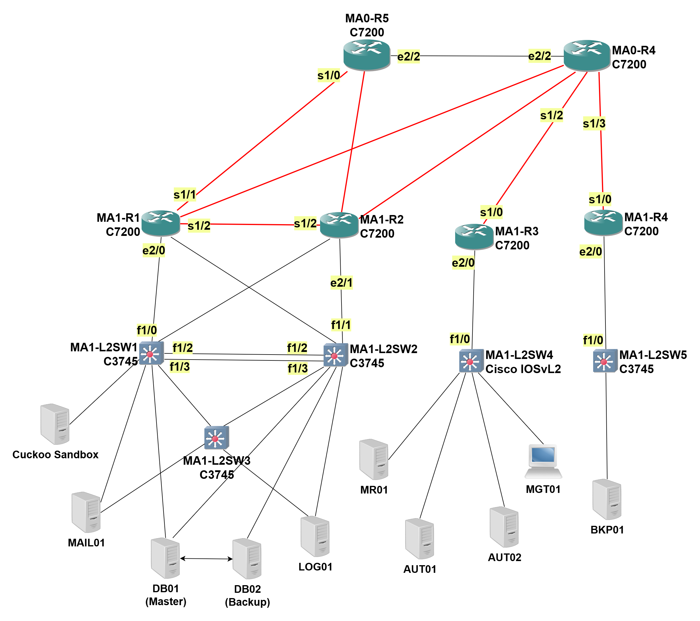](../../assets/datacenter-area1-physical.png)

*전산망 라우터와 스위치의 인터페이스 연결, 스위치 간 병렬 링크 및 서버 연결 구조.*

[구성도 원본 확대 보기](../../assets/datacenter-area1-physical.png)

중복 장비 배치, 프로토콜 역할 변화, 실제 서비스 응답을 서로 다른 검증 항목으로 구분함.

### HSRP 게이트웨이 상태 전환 확인

전산망 라우터 MA1-R1과 MA1-R2의 HSRP 상태를 비교했습니다. 장애 전에는 MA1-R1이 4개 그룹에서 Active였으며, 장애 후에는 MA1-R2가 동일한 가상 IP를 유지하며 Active로 표시되는 것을 확인했습니다.

**장애 전 — MA1-R1**

[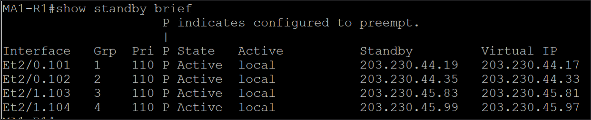](../../assets/hsrp-before.png)

**장애 후 — MA1-R2**

[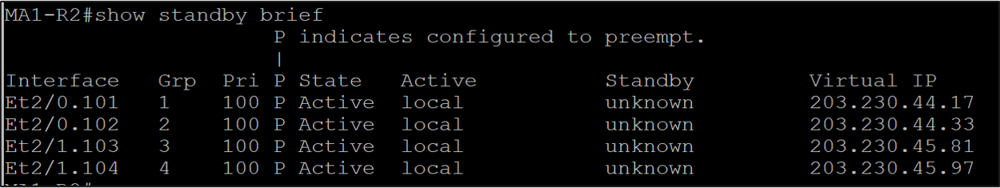](../../assets/hsrp-after.png)

두 화면은 HSRP의 Active 상태 전환을 보여줍니다. 전환 시간과 패킷 손실, 실제 서비스 통신 유지 여부는 이 화면만으로 판단할 수 없으며, 연속 Ping과 서비스 요청을 함께 기록하는 추가 검증이 필요합니다.

## 접근 통제와 VPN

NAT/PAT는 주소 변환, ACL·방화벽은 통신 허용·거부를 담당함. Outside·Inside·DMZ 경계와 내부 라우팅·서비스 정책을 함께 검토함.

| 통신 종류 | 설계·검토 관점 |
| --- | --- |
| 외부→공개 서비스 | 공개 진입점과 허용 포트 |
| 서비스 계층 간 | LB·웹·앱·DB의 출발지·목적지 |
| 관리 접속 | 관리 주체와 대상 장비·서버 |
| 수집·백업 | 수집 방향·리스너·허용 포트 |
| 캠퍼스 간 연구 통신 | 터널 경로·암호화·반환 경로 |

[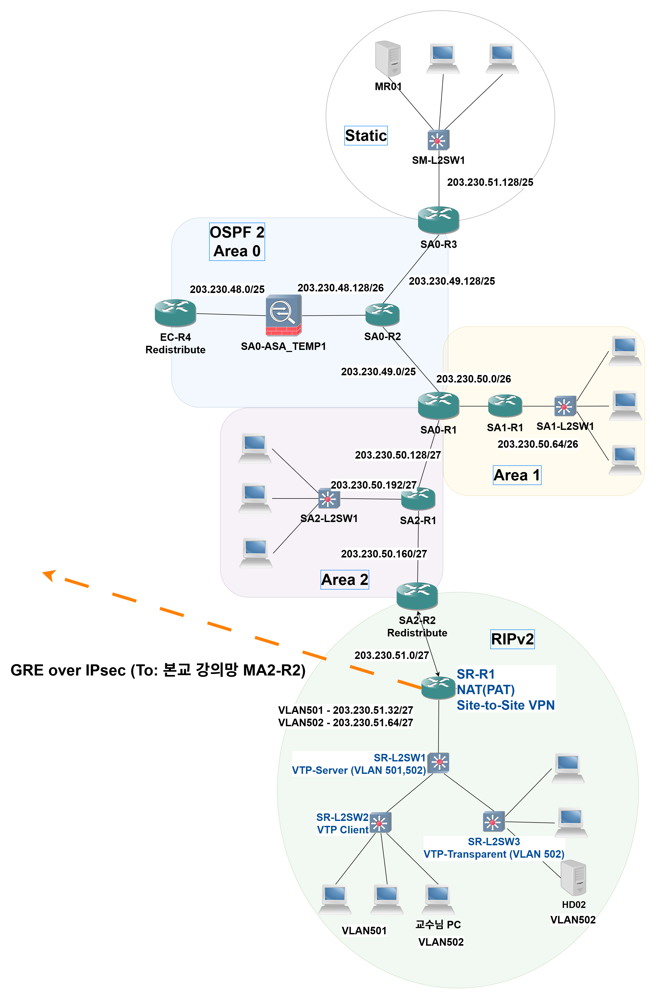](../../assets/branch-campus-logical.png)

*분교 OSPF Area 0·1·2와 연구망 RIPv2의 연결, 본교 강의망으로 이어지는 GRE over IPsec 터널.*

[구성도 원본 확대 보기](../../assets/branch-campus-logical.png)
GRE over IPsec 설정에 터널 MTU 1400과 TCP MSS 1360을 반영함. 후속 검증은 터널 상태·ESP 패킷·양방향 서비스 응답을 함께 확인하는 방식으로 구성함.

VPN은 ISAKMP 기반으로 구성됐으며, 레거시 암호 설정은 개선 항목으로 정리함. VPN SA·암복호화 카운터와 양방향 서비스 응답을 함께 확보해야 터널 상태와 실제 서비스 연결을 설명할 수 있음.

### ASA 접근 정책 검사

ASDM Packet Tracer에서 동일한 출발지·목적지에 대해 UDP 53과 ICMP의 정책 처리 결과를 비교함.

| 입력 조건 | 출발지 | 목적지 | 검사 결과 |
| --- | --- | --- | --- |
| UDP 목적지 포트 53 | 203.230.40.131 | 203.230.46.136 | 허용 |
| ICMP Echo Request | 203.230.40.131 | 203.230.46.136 | ACL에 의해 차단 |

#### UDP 53 허용

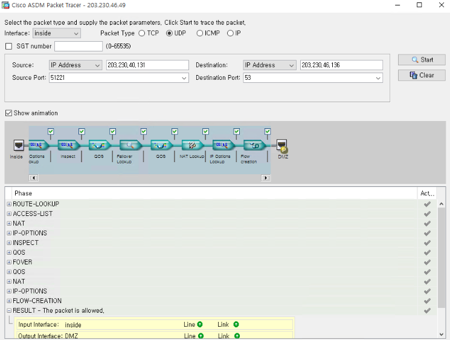

*Inside에서 DMZ 방향으로 입력한 UDP 53 패킷의 검사 결과가 The packet is allowed로 표시됨.*

#### ICMP 차단

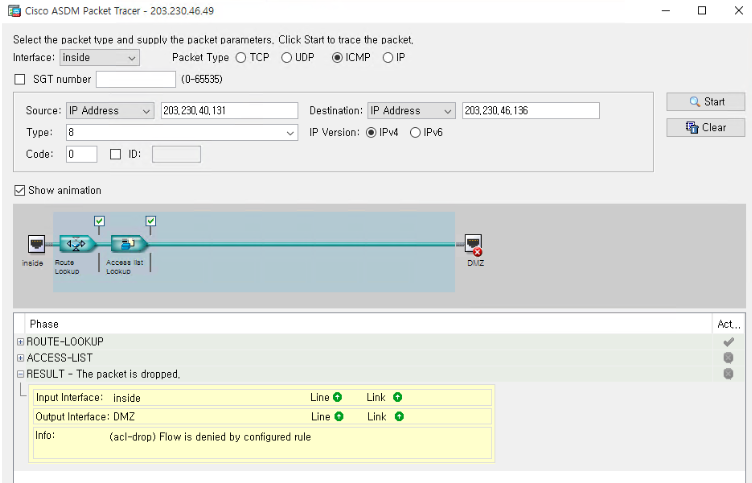

*ICMP Echo Request의 검사 결과가 The packet is dropped로 표시됐으며, acl-drop 사유를 확인함.*

이 결과는 ASA 내부의 가상 패킷 처리 검사이며, 실제 DNS 응답이나 종단 간 통신 성공을 의미하지 않음.

## 서비스와 운영보안 연계

### 서버 서비스

LB→웹·애플리케이션→내부 DB의 흐름을 중심으로 구성함. HAProxy·Keepalived, Apache·PHP-FPM/Gunicorn, MariaDB와 DNS·메일·파일 공유의 연결을 네트워크 포트·경로·접근 정책 관점에서 검토함.

DB 복제와 백업, 백업 파일 생성과 복원 성공, VIP 전환과 서비스 무중단을 각각 구분함.

#### 학생 정보 조회 서비스 흐름

사용자의 DNS 조회부터 HTTPS 접속, 로드밸런서와 웹·애플리케이션 서버를 거쳐 내부 DB를 조회하고 응답하는 과정을 정리했습니다.

서비스 통신 흐름 보기 (GIF)

<a href="../../assets/student-service-flow.gif">
  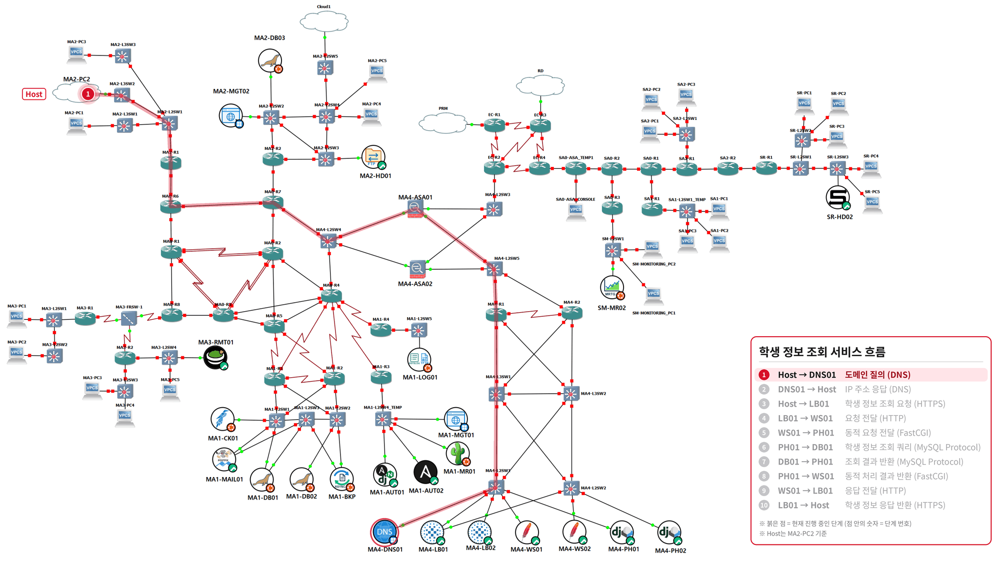
</a>

이미지를 클릭하면 원본 크기로 볼 수 있습니다.

### 모니터링·로그·백업

SNMP 기반 Cacti/MRTG, rsyslog 중앙 로그, TFTP/Kron 설정 백업과 Ansible 관리 경로를 사용자 서비스 통신과 구분함. Ansible은 장비별 설정 표준화와 관리 작업 연계 범위로 정리함.

| 운영 경로 | 확인할 근거 |
| --- | --- |
| SNMP 수집 | 대상·인증·허용 범위·폴링 결과 |
| 로그 전송 | 송신 설정·수신 리스너·저장 이벤트 |
| 설정 백업 | 전송 결과·생성 파일·복구 시험 |
| 자동화 | 인벤토리·대상 작업·실행 로그·사후 검증 |

#### Cacti 트래픽 모니터링

SNMP 기반 Cacti 그래프를 통해 DB01의 bond0 인터페이스 송수신 트래픽을 확인함. 수집 기간의 트래픽 변화를 보여주는 운영 자료이며, 이 화면만으로 최대 처리 성능이나 장애 원인을 판단하지 않음.

[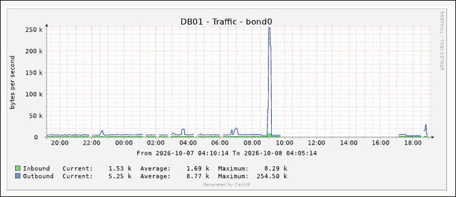](../../assets/cacti-traffic-monitoring.png)

*이미지를 클릭하면 원본 크기로 확인할 수 있음.*

### 모의해킹과 보안 관제

외부 공개 접점 조사, 웹·메일 입력, 내부 접근·권한 경계 시나리오를 네트워크 정책 검증과 연결함. Snort/Suricata·Wazuh·ELK/Splunk는 네트워크·호스트 이벤트의 관측 지점과 로그 전달 흐름을 중심으로 설명함.

보안 검증에서는 요청 시각·대상·패킷·경보·최종 서비스 응답을 대조함. 탐지 기록과 실제 차단 결과를 별도로 확인하는 것을 기준으로 삼음.

## 장애 분석과 후속 검증

### ASA 역할 절체와 데이터 통신의 차이

[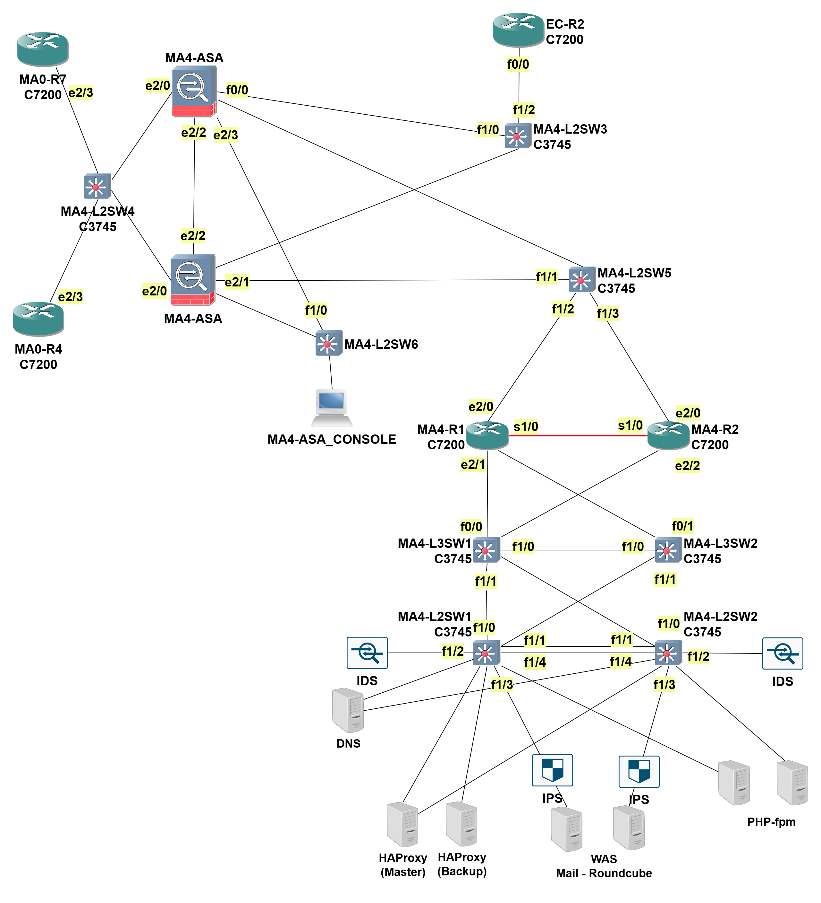](../../assets/dmz-area4-physical.png)

*ASA 쌍과 내부·외부·DMZ 스위치의 인터페이스 연결 구조. 절체 시험의 연결 환경을 설명하는 구성도.*

[구성도 원본 확대 보기](../../assets/dmz-area4-physical.png)

1. show failover로 Primary/Secondary Pair와 Active/Standby 상태를 확인함.
2. no failover active로 수동 절체한 뒤 역할·IP 인계를 비교함.
3. 양 장비의 데이터 인터페이스 감시가 Normal (Waiting)에 머무는 것을 확인함.
4. ASA CLI의 Ping 결과와 Wireshark에 기록된 Echo Request·Reply를 비교함.
5. 응답 프레임의 가상 NIC·Virtual MAC 처리 구간을 추가 확인 대상으로 좁힘.

#### 절체 전 상태

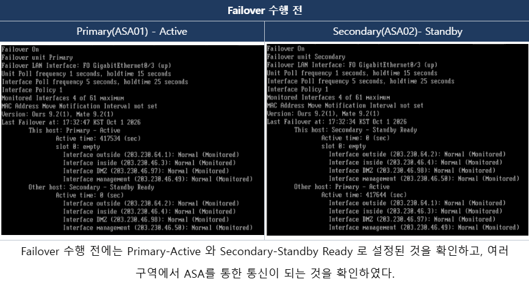

*Primary Active와 Secondary Standby Ready 상태, 인터페이스의 Normal (Monitored) 표시.*

#### 절체 후 상태

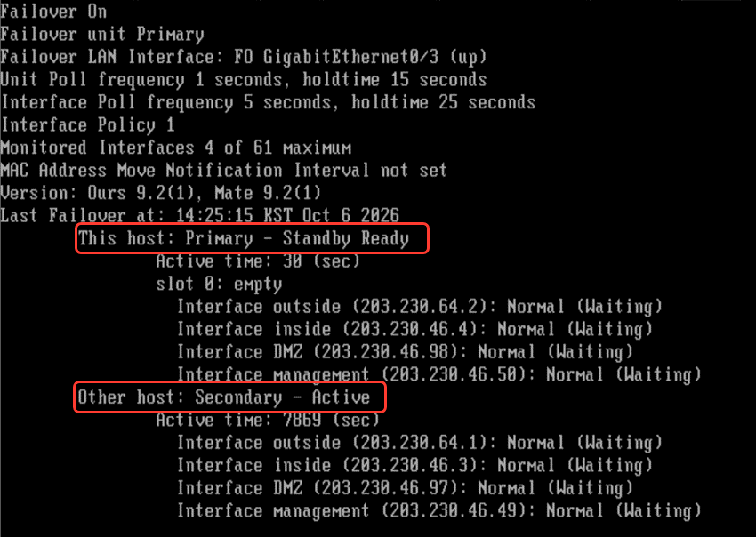

*Primary Standby Ready와 Secondary Active로 전환된 상태 및 IP 인계. 인터페이스 감시는 Normal (Waiting)으로 표시됨.*

두 화면은 기록 날짜가 다른 절체 전·후 상태 자료임.

#### ICMP 응답 비교

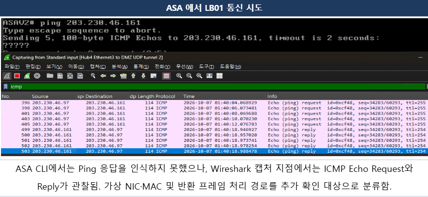

*ASA CLI의 Ping 결과는 ?????로 표시됐으나, Wireshark 캡처 지점에서는 ICMP Echo Request와 Reply가 관찰됨. 가상 NIC·MAC 및 반환 프레임 처리 경로는 추가 확인 대상으로 분류함.*

| 결과 | 판정 |
| --- | --- |
| Pair 형성·수동 역할 전환·IP 인계 | 확인 |
| 외부 캡처 지점의 Echo Request·Reply | 확인 |
| Failover Monitoring 정상화 | 미완료 |
| 종단 서비스 연속성 | 미검증 |
| 가상 NIC·MAC 처리 문제 | 원인 후보, 확정 아님 |

후속 검증은 Echo Reply의 목적지 MAC과 Active ASAv MAC 비교, ASA 자체 capture와 외부 캡처의 시점 대조, 가상 스위치 정책을 통제할 수 있는 환경의 재현으로 구성함.

### 링크 장애 후 통신 미복구

전산망 스위치 간 LACP EtherChannel에서 일부 물리 링크를 차단한 뒤, 링크 집성 상태와 실제 통신 결과를 비교했습니다.

**1. 장애 전 — 두 링크 집성 참여**

Po10은 SU 상태이며, Gi0/1과 Gi0/2 모두 P 상태로 집성에 참여했습니다.

[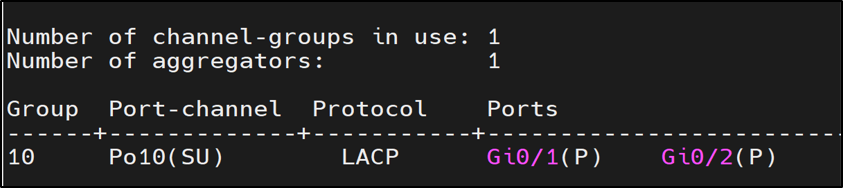](../../assets/etherchannel-before.png)

**2. 링크 차단 후 — 잔여 링크 유지**

Gi0/1 차단 후 해당 포트는 D로 표시됐으며, Gi0/2는 P, Po10은 SU 상태를 유지했습니다. 이 출력만으로 실제 데이터 통신의 정상 여부를 판단할 수는 없습니다.

[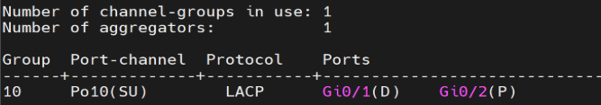](../../assets/etherchannel-after.png)

**3. 실제 통신 — Ping 응답 중단**

203.230.45.100 대상 연속 Ping은 응답을 받다가 icmp_seq=13부터 화면에 기록된 마지막 요청까지 timeout이 발생했습니다. 보고서에는 차단한 링크를 복구한 뒤 Ping 응답이 재개됐다고 기록했습니다.

[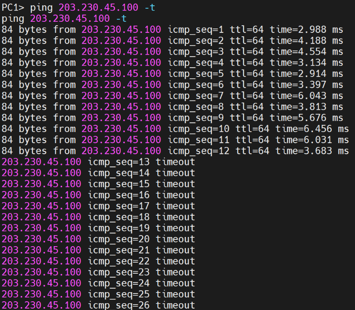](../../assets/etherchannel-ping-loss.png)

**분석과 후속 검증**

잔여 링크가 집성에 참여한 상태와 실제 통신 유지 여부가 다를 수 있음을 확인했습니다. 이번 시험에서는 링크 장애 시 통신 유지 목표를 충족하지 못했으며, 정확한 원인은 확정하지 못했습니다.

재시험에서는 양쪽 스위치의 Port-channel 설정, 허용 VLAN과 Trunk 상태, STP 상태, 최소 활성 링크 조건을 점검하고 장애 시점의 로그와 패킷을 함께 확보할 계획입니다. 가상화 환경의 제약 가능성도 원인 후보로 두되, 추가 근거 없이 원인으로 단정하지 않습니다.

## 결과와 배운 점

게이트웨이·L2·방화벽의 이중화를 구분하고, 상태 표시와 종단 통신이 일치하는지 검증해야 한다는 기준을 정리함. 장애 원인은 CLI만으로 단정하지 않고 패킷·역할·인터페이스·반환 경로를 함께 비교함.

추가 검증 항목은 게이트웨이 절체 시 패킷 손실·복구 시간, VPN 암복호화 카운터·서비스 응답, 링크 장애 시 잔여 경로임. ASA 인터페이스 감시와 종단 통신 정상화는 미완료 상태로 남김.

[프로젝트 요약](README.md) · [포트폴리오 메인](../../README.md)
