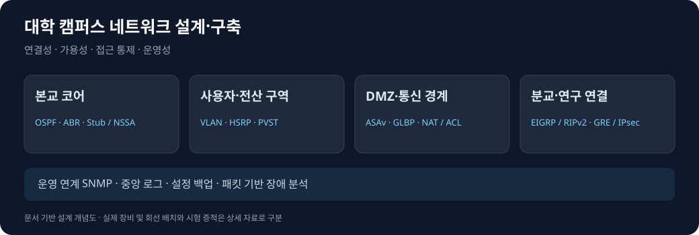

# 대학 캠퍼스 네트워크 설계·구축 상세 기록

[프로젝트 요약](README.md) · [포트폴리오 메인](../../README.md)

[소개와 범위](#소개와-범위) · [라우팅](#구역과-라우팅-설계) · [이중화](#계층별-이중화와-검증-범위) · [VPN·통제](#접근-통제와-vpn) · [장애 분석](#장애-분석과-후속-검증)

## 소개와 범위

> 외부 운영망과 분리된 GNS3·VMware 실습 환경을 대상으로 함. 팀 프로젝트 중 네트워크 구상·구현을 담당했으며, 서버·공격·관제는 연계 범위로 설명함.

전체 프로젝트의 인프라와 보안 검증을 네트워크 연결성·가용성·접근 통제·운영성 관점으로 재구성함. 기간은 자료별 차이를 고려해 2026년 9~10월로 표기함. 기획안 본문은 9월 21일~10월 7일이며 일정표는 10월 12일까지 포함함.

*문서 기반 재작성 개념도이며, 실제 물리 토폴로지나 시험 증적을 대체하지 않음.*

## 구역과 라우팅 설계

| 구역 | 구성 | 설계 목적 |
| --- | --- | --- |
| 본교 코어 | OSPF 백본·ABR | 용도별 Area 연결 |
| 전산망 | VLAN·HSRP·PVST | 서비스·관리 구역과 중복 경로 구성 |
| 강의·학생망 | VLAN·OSPF·DHCP | 사용자 구역 분리와 접속 제공 |
| DMZ | ASAv·SVI·GLBP | 외부 공개 서비스의 통신 경계 |
| 분교·연구망 | OSPF·RIPv2·GRE/IPsec | 캠퍼스 간 연구·관리 연결 |
| 외부 코어 | EIGRP·Redistribution | 이종 라우팅 도메인 연동 |
| 운영망 | SNMP·로그·설정 백업 | 상태 확인·장애 분석·복구 준비 |

장비 설정 메모에 OSPF Area 1 Stub/no-summary와 Area 4 NSSA 설정이 포함됨. 설정 메모에는 미완성·수정 기록도 있어 모든 구문을 최종 running-config로 간주하지 않음.

경로 검증은 이웃 형성, 목적지 경로 학습, 실제 전송과 반환 경로의 순서로 확인하도록 정리함.

| 확인 지점 | 확인 방법 | 판단 기준 |
| --- | --- | --- |
| OSPF 이웃 | show ip ospf neighbor | 의도한 장비 사이 인접 관계 |
| 경로 출처 | show ip route | 내부·외부 경로와 next hop |
| 전달 경로 | traceroute·패킷 캡처 | 의도한 경계·목적지로 전달 |
| 양방향 통신 | 송수신 결과 대조 | 요청뿐 아니라 응답 반환 확인 |

재분배 루프 방지·수렴 시간·손실률의 개선 효과는 측정하지 않은 수치로 제시하지 않음.

## 계층별 이중화와 검증 범위

| 계층 | 기술 | 문서에서 확인한 범위 | 남은 검증 |
| --- | --- | --- | --- |
| 기본 게이트웨이 | HSRP | 동일 VIP·priority·preempt 설정, 기존 초안의 역할 전환 기록 | 시험 원본 대조·손실·복구 시간 |
| DMZ 게이트웨이 | GLBP | VLAN별 VIP·priority·preempt 설정 | 장애 조건별 전달·역할 변화 |
| L2 경로 | PVST | VLAN별 Primary/Secondary 교차 배치 기록 | 루트·차단 포트와 장애 경로 |
| 링크 묶음 | EtherChannel | 기존 초안에 단일 링크 중단 후 통신 실패 기록 | 멤버·포트채널·종단 경로 |
| 방화벽 | ASAv Active/Standby | 수동 역할 전환·IP 인계 | 인터페이스 감시·종단 서비스 연속성 |

중복 장비 배치, 프로토콜 역할 변화, 실제 서비스 응답을 서로 다른 검증 항목으로 구분함.

## 접근 통제와 VPN

NAT/PAT는 주소 변환, ACL·방화벽은 통신 허용·거부를 담당함. Outside·Inside·DMZ 경계와 내부 라우팅·서비스 정책을 함께 검토함.

| 통신 종류 | 설계·검토 관점 |
| --- | --- |
| 외부→공개 서비스 | 공개 진입점과 허용 포트 |
| 서비스 계층 간 | LB·웹·앱·DB의 출발지·목적지 |
| 관리 접속 | 관리 주체와 대상 장비·서버 |
| 수집·백업 | 수집 방향·리스너·허용 포트 |
| 캠퍼스 간 연구 통신 | 터널 경로·암호화·반환 경로 |

GRE over IPsec 설정에 터널 MTU 1400과 TCP MSS 1360이 기록됨. 기존 초안에는 터널 형성과 ESP 패킷 관찰이 기재돼 있으나 원본 시험 화면의 추가 대조가 필요함.

기술 목록의 IKEv2와 달리 설정은 crypto isakmp 기반임. 구현 버전 표기를 설정과 일치시키고, 레거시 암호 설정은 개선 대상으로 구분함. VPN SA·암복호화 카운터와 양방향 서비스 응답을 함께 확보해야 터널 상태와 실제 서비스 연결을 설명할 수 있음.

## 서비스와 운영보안 연계

### 서버 서비스

LB→웹·애플리케이션→내부 DB의 흐름을 중심으로 구성함. HAProxy·Keepalived, Apache·PHP-FPM/Gunicorn, MariaDB와 DNS·메일·파일 공유는 팀 서비스 환경이며, 네트워크 포트·경로·접근 정책을 설명하는 범위로 활용함.

DB 복제와 백업, 백업 파일 생성과 복원 성공, VIP 전환과 서비스 무중단을 각각 구분함.

### 모니터링·로그·백업

SNMP 기반 Cacti/MRTG, rsyslog 중앙 로그, TFTP/Kron 설정 백업과 Ansible 관리 경로를 사용자 서비스 통신과 구분함. 자동화용 설정 메모를 실제 전체 배포 성공이나 작업 시간 절감 성과로 확대하지 않음.

| 운영 경로 | 확인할 근거 |
| --- | --- |
| SNMP 수집 | 대상·인증·허용 범위·폴링 결과 |
| 로그 전송 | 송신 설정·수신 리스너·저장 이벤트 |
| 설정 백업 | 전송 결과·생성 파일·복구 시험 |
| 자동화 | 인벤토리·대상 작업·실행 로그·사후 검증 |

### 모의해킹과 보안 관제

기획안의 외부 공개 접점 조사, 웹·메일 입력, 내부 접근·권한 경계 시나리오를 네트워크 정책의 검증 배경으로 남김. Snort/Suricata·Wazuh·ELK/Splunk 등은 관측 지점과 로그 흐름을 설명하는 연계 기술이며 개인 개발·운영 성과로 일괄 표기하지 않음.

기획상의 룰·대응 목표는 실제 탐지·차단 성공과 구분함. 검증 결과는 요청·시각·대상·패킷·경보·최종 서비스 응답을 연결할 수 있는 범위에서만 작성함.

## 장애 분석과 후속 검증

### ASA 역할 절체와 데이터 통신의 차이

1. show failover로 Primary/Secondary Pair와 Active/Standby 상태를 확인함.
2. no failover active로 수동 절체한 뒤 역할·IP 인계를 비교함.
3. 양 장비의 데이터 인터페이스 감시가 Normal (Waiting)에 머무는 것을 확인함.
4. ASA CLI의 Ping 실패와 같은 시점의 Wireshark Echo Request·Reply를 대조함.
5. 응답 프레임의 가상 NIC·Virtual MAC 처리 구간을 추가 확인 대상으로 좁힘.

| 결과 | 판정 |
| --- | --- |
| Pair 형성·수동 역할 전환·IP 인계 | 확인 |
| 외부 캡처 지점의 Echo Request·Reply | 확인 |
| Failover Monitoring 정상화 | 미완료 |
| 종단 서비스 연속성 | 미검증 |
| 가상 NIC·MAC 처리 문제 | 원인 후보, 확정 아님 |

후속 검증은 Echo Reply의 목적지 MAC과 Active ASAv MAC 비교, ASA 자체 capture와 외부 캡처의 시점 대조, 가상 스위치 정책을 통제할 수 있는 환경의 재현으로 구성함.

### 링크 장애 후 통신 미복구

기존 초안에는 EtherChannel 단일 링크 shutdown 이후 Ping이 복구되지 않아 링크를 재활성화한 결과가 있음. 구성원·논리 인터페이스 상태와 실제 종단 응답을 대조하고 잔여 링크의 전달 경로를 재검증해야 함.

## 결과와 배운 점

게이트웨이·L2·방화벽의 이중화를 구분하고, 상태 표시와 종단 통신이 일치하는지 검증해야 한다는 기준을 정리함. 장애 원인은 CLI만으로 단정하지 않고 패킷·역할·인터페이스·반환 경로를 함께 비교함.

이 문서는 기존 네트워크·IDC 초안, 기획안, 장비 설정 메모와 ASA 시험 보고서를 바탕으로 작성함. HSRP·ESP 등 기존 초안이 인용한 최종 보고서의 시험 결과는 원본 증적 추가 대조 전까지 검증 범위를 제한함. 실제 증적 화면은 아직 이 저장소에 포함하지 않음.

[프로젝트 요약](README.md) · [포트폴리오 메인](../../README.md)
