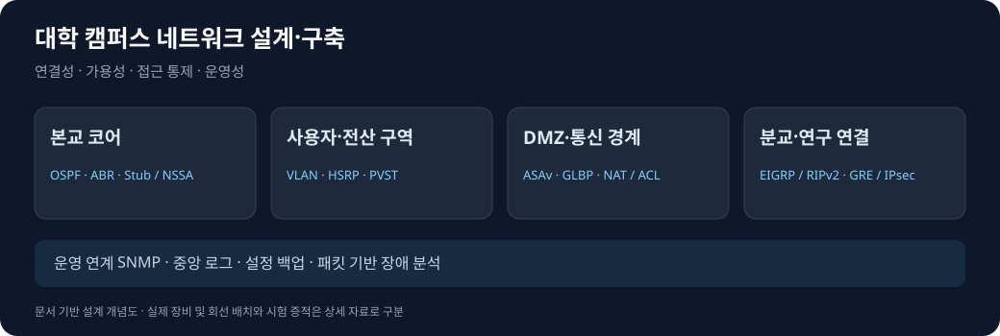

# 가용성과 접근 통제를 고려한 대학 캠퍼스 네트워크 설계·구축

**[상세히 보기](DETAIL.md)** · [포트폴리오 메인](../../README.md)

[프로젝트 소개](#프로젝트-소개) · [역할](#역할) · [주요 결과](#주요-결과) · [핵심 작업](#핵심-작업) · [문제 해결](#문제-해결)

## 프로젝트 소개

학사·연구·관리 서비스를 제공하는 대학을 가정하고 본교·분교와 외부망을 연결하는 가상 네트워크를 구성함. 정상 상태의 연결뿐 아니라 장비·경로 장애 이후 사용할 수 있는 경로와 접근 통제 경계를 설계의 중심으로 삼음.

| 항목 | 내용 |
| --- | --- |
| 수행 시기 | 2026년 9~10월 |
| 원 프로젝트 | 대학 IT 인프라 구축 및 모의해킹 기반 통합 보안관제 체계 구현 |
| 수행 형태 | 팀 프로젝트 중 네트워크 구상·구현 담당 |
| 환경 | GNS3, VMware Workstation, Cisco IOS·ASAv |
| 핵심 기술 | OSPF, EIGRP, RIPv2, VLAN, HSRP, GLBP, PVST, NAT/PAT, ACL, GRE/IPsec |
| 분석·운영 연계 | Wireshark, SNMP, Cacti/MRTG, rsyslog, TFTP/Kron, Ansible |

*프로젝트 자료의 구역과 기술을 요약해 재작성한 개념도. 실제 장비·회선 배치도는 아님.*

## 역할

| 담당 범위 | 수행 내용 |
| --- | --- |
| 네트워크 구상·구현 | 본교·분교와 용도별 구역을 연결하는 구조, VLAN·주소·라우팅 구성 |
| 가용성 설계 | 게이트웨이·L2·방화벽의 이중화 방식과 장애 검증 지점 구분 |
| 통신 경계 | 공개 서비스·내부 자원·관리 접근의 경로와 정책 구성 |
| 운영 연계 | 서비스 포트, 상태·로그 수집, 장비 설정 백업의 통신 경로 검토 |

네트워크 구상·구현을 개인 담당 범위로 기술함. 서버·공격·관제 구축과 시험 기록은 팀 산출물이며, 서비스 연결과 통제·장애 분석에 필요한 범위로 설명함.

## 주요 결과

| 항목 | 확인 범위 |
| --- | --- |
| 구역·라우팅 구성 | 본교 OSPF 백본·Area와 VLAN 분리, EIGRP·RIPv2 경계 재분배 설정 |
| 게이트웨이 이중화 | HSRP·GLBP와 PVST 설정. 기존 초안에 HSRP Standby→Active 전환 기록이 있으며 원본 시험 증적 추가 대조 필요 |
| 캠퍼스 간 연결 | GRE over IPsec, MTU 1400·TCP MSS 1360 설정. ESP 관찰 결과는 기존 초안에 기록됨 |
| ASA 절체 | 수동 Active/Standby 역할 전환과 IP 인계 확인. 인터페이스 감시·종단 통신 정상화는 미완료 |
| 운영 경로 | 상태·로그 수집과 장비 설정 백업의 대상·방향을 서비스 통신과 구분 |

## 핵심 작업

### OSPF 계층화와 이종 라우팅 연동

본교 백본과 전산·강의·학생·DMZ를 용도별로 구분함. ABR과 Stub/NSSA 구성, 외부 EIGRP 및 연구망 RIPv2와의 재분배를 통해 구간별 경로를 연결함. 설정 여부와 실제 경로 학습·반환 경로 검증을 구분함.

[구역과 라우팅 설계](DETAIL.md#구역과-라우팅-설계)

### VLAN·게이트웨이·방화벽의 계층별 이중화

VLAN과 Trunk로 논리 구역을 분리하고, HSRP·GLBP는 기본 게이트웨이, PVST는 중복 L2 경로의 루프 방지, ASA는 방화벽 역할 절체를 담당하도록 구성함. 역할 전환 성공을 서비스 무중단으로 확대하지 않음.

[계층별 이중화와 검증 범위](DETAIL.md#계층별-이중화와-검증-범위)

### DMZ·NAT·ACL·VPN의 통신 경계

공개 서비스와 내부 자원을 구분하고, 주소 변환과 접근 통제의 역할을 분리함. 연구망 GRE over IPsec 설정에 터널 MTU와 TCP MSS를 반영함. 기술 목록의 IKEv2 표기와 실제 ISAKMP 설정 차이는 정리 대상으로 남김.

[접근 통제와 VPN](DETAIL.md#접근-통제와-vpn)

### 서버·관제·보안 검증의 연계

LB→웹·애플리케이션→DB의 서비스 흐름과 관리·로그·모니터링·백업 통신을 나눠 설명함. 모의해킹은 외부 노출과 내부 접근 경계를 점검하는 시나리오로, 관제는 해당 요청을 관찰할 패킷·로그 수집 지점으로 연결함. 개별 서버 설치와 전체 공격·관제 도구 개발은 개인 구현 성과에 포함하지 않음.

[서비스와 운영·보안 연계](DETAIL.md#서비스와-운영보안-연계)

## 문제 해결

### ASA 역할 절체 후 ICMP 응답 미인식

수동 절체와 IP 인계는 성공했지만 인터페이스가 Normal (Waiting)에 머물고 ASA CLI는 Ping 응답을 인식하지 못함. 같은 시점의 Wireshark에서 Echo Request·Reply를 확인해 역할 상태와 데이터 통신을 분리함. 가상 NIC·Virtual MAC·반환 프레임 처리 구간을 원인 후보로 좁혔으며 근본 원인 확정과 종단 서비스 연속성 검증은 미완료임.

### 단일 링크 중단 후 통신 미복구

기존 초안에 EtherChannel 단일 링크 중단 후 잔여 링크로 Ping이 복구되지 않은 결과가 기록됨. 성공 사례로 집계하지 않고 포트채널·멤버 설정·종단 경로·가상화 환경을 분리해 재검증할 항목으로 남김.

[장애 분석과 후속 검증](DETAIL.md#장애-분석과-후속-검증)

**[상세히 보기](DETAIL.md)** · [포트폴리오 메인](../../README.md)
